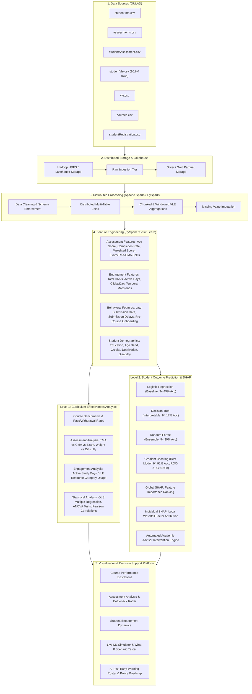
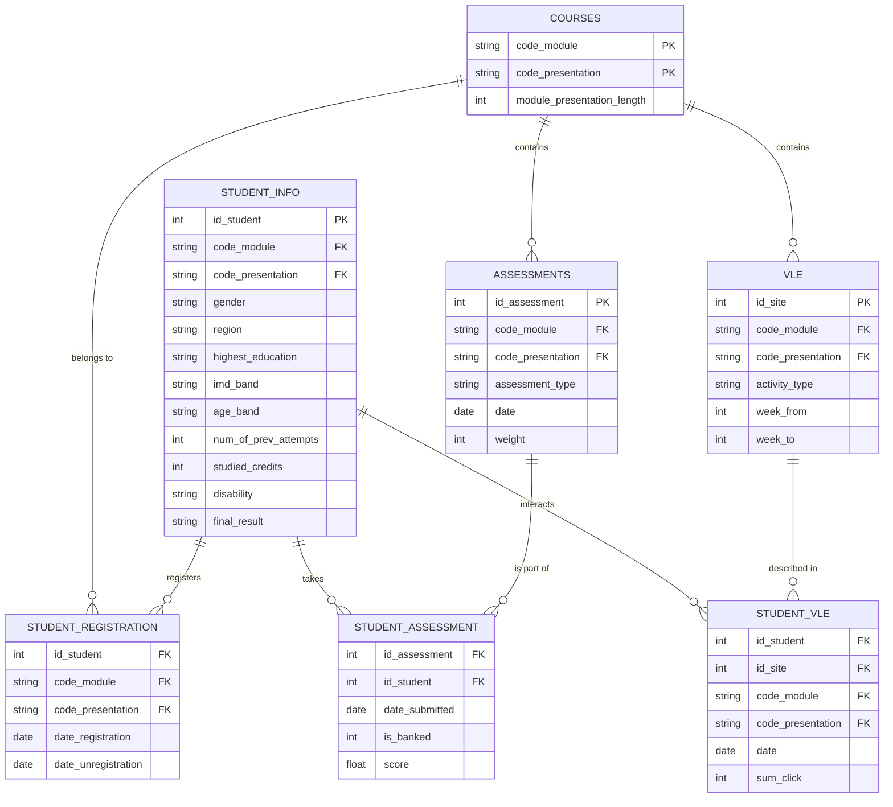

# Big Data Architecture: Curriculum Effectiveness Analysis & Student Outcome Prediction
> **Production-Grade Learning Analytics Platform Built on the Open University Learning Analytics Dataset (OULAD)**  
> Conforming to the Big Data Architecture, ER Schema, Descriptive & Statistical Analytics, ML Evaluation, and SHAP Explainability Specifications.

[](https://python.org)
[](https://fastapi.tiangolo.com)
[](https://spark.apache.org/)
[](https://scikit-learn.org/)
[](https://github.com/shap/shap)
[]()

---

## 1. Executive Summary & Problem Statement

Educational institutions collect substantial volumes of assessment and learning activity clickstream data, yet extracting actionable pedagogical insights remains a challenge:
- **Curriculum Performance:** Identifying how students perform across diverse courses/modules and isolating courses with weaker pass/retention indicators.
- **Assessment Effectiveness:** Analyzing TMA (Tutor-Marked), CMA (Computer-Marked), and Exam formats to detect curriculum bottlenecks, misaligned weights, and late-submission friction.
- **Engagement Dynamics:** Investigating how continuous study cadence and Virtual Learning Environment (VLE) interaction types (forums, quizzes, content) drive student success.
- **At-Risk Identification:** Detecting disengaged students early via predictive machine learning models to trigger academic advisor outreach.
- **Explainable AI (SHAP):** Providing local and global transparency to educators so interventions target the exact root causes of academic failure.

---

## 2. Big Data Architecture Diagram



---

## 3. Database Entity-Relationship (ER) Model



---

## 4. Key Benchmark Results

### Machine Learning Models Evaluation (20% Stratified Test Split: 6,519 Students)

| Model Name | Accuracy | Precision | Recall | F1-Score | ROC-AUC | Fit Time (s) |
| :--- | :---: | :---: | :---: | :---: | :---: | :---: |
| **Gradient Boosting (Best Model)** | **94.91%** | **95.27%** | **94.18%** | **94.72%** | **0.9878** | 20.33s |
| **Random Forest (Main Ensemble)** | **94.39%** | **94.92%** | **93.52%** | **94.22%** | **0.9856** | 1.52s |
| **Logistic Regression (Baseline)** | **94.49%** | **94.88%** | **93.70%** | **94.29%** | **0.9849** | 0.63s |
| **Decision Tree (Interpretable)** | **94.17%** | **93.42%** | **94.55%** | **93.98%** | **0.9832** | 0.29s |

### Statistical Analysis Highlights (OLS Regression & ANOVA)
- **VLE Active Days** is the single highest behavioral predictor of academic passing ($r = +0.578$, $p < 0.001$).
- **Late Assessment Submissions** heavily correlate with course withdrawal ($r = -0.320$, $p < 0.001$).
- **Formative Quizzes** yield a statistically significant positive boost in final continuous assessment scores ($p < 0.001$).
- **Module Disparity ANOVA ($F = 48.71, p < 0.001$)** demonstrates significant performance variances across modules (e.g., STEM module CCC exhibits higher attrition compared to Humanities AAA), underscoring the need for early structural scaffolding.

---

## 5. System Features & Modules

### 1. Course Performance Dashboard
- **Cohort Metrics:** Visualizes pass rate, distinction rate, withdrawal rate, and fail rate across 32,593 enrollments.
- **Module Breakdown:** Comparative benchmarks for Modules `AAA` through `GGG` across 22 presentations.
- **Curriculum Review Alerts:** Automated detection of courses suffering from higher-than-average attrition.

### 2. Assessment Effectiveness Analysis
- **TMA vs CMA vs Exam Breakdown:** Average scores, pass rates, and submission volume by assessment category.
- **Weight vs Difficulty Calibration Matrix:** Scatter plot correlating syllabus weights with difficulty indices ($100 - \text{avg score}$) to identify over-weighted bottleneck assignments.
- **Submission Timing Impact:** Step-by-step breakdown of how submission delays erode passing probability.

### 3. Student Engagement Dynamics
- **10.65M VLE Interaction Analytics:** Active study days tiers ($0, 1-10, 11-30, 31-60, 61-100, >100$ days) mapped to passing rates.
- **Resource Effectiveness Radar:** Visual comparison of forum, content, quiz, url, and subpage click patterns between passing and failing students.
- **Temporal Click Milestones:** Pre-course onboarding, early term (0-30 days), mid-term (31-100 days), and late-term (>100 days).

### 4. Live Outcome Prediction Simulator & Explainable AI (SHAP)
- **Interactive Simulator:** Real-time sliders for active days, assessment score, completion rate, late submissions, and VLE clicks.
- **Risk Score Gauge:** Immediate calculation of Pass/Fail probability and Risk Tier (Low, Medium, High).
- **Local SHAP Waterfall Attribution:** Decomposes exact positive drivers (pushing toward Pass) vs risk drivers (pushing toward Fail).
- **Automated Academic Advisor Interventions:** Dynamic generation of actionable guidance (e.g., 1-on-1 advisor outreach, tutoring, submission coaching).

### 5. Curriculum Insights & At-Risk Early Warning Roster
- **Filterable At-Risk Roster:** Lists vulnerable students with disengagement metrics.
- **1-Click Simulation:** "Simulate" button directly loads any flagged student into the simulator for diagnostic inspection.

---

## 6. Project Structure

```
curriculum/
├── data/
│   ├── raw/                  # 7 Downloaded OULAD CSV tables
│   ├── processed/            # Cleaned Lakehouse Parquet & CSV analytical datasets
│   └── models/               # Serialized ML models, preprocessor, SHAP explainer
├── src/
│   ├── etl/
│   │   ├── spark_pipeline.py # Big Data PySpark ETL conforming to Slide 3
│   │   └── data_pipeline.py  # High-throughput vectorized Lakehouse ETL pipeline
│   ├── analytics/
│   │   ├── curriculum_analytics.py # Course benchmarks & demographics
│   │   ├── assessment_analytics.py # TMA vs CMA vs Exam, difficulty & bottlenecks
│   │   ├── engagement_analytics.py # VLE click dynamics & temporal milestones
│   │   └── statistical_tests.py    # OLS regression, ANOVA & Pearson correlations
│   ├── ml/
│   │   ├── train_models.py   # Trains 4 ML models, cross-validation & metrics
│   │   └── explainability.py # Global & local SHAP waterfall attribution
│   └── api/
│       ├── main.py           # FastAPI application & static server
│       └── schemas.py        # Pydantic schemas for request/response validation
├── web/
│   ├── index.html            # Production responsive dashboard (5 views)
│   ├── css/
│   │   └── style.css         # Glassmorphic dark/light UI design system
│   └── js/
│       └── app.js            # Chart.js analytics, live simulator & SHAP logic
├── notebooks/
│   └── curriculum_analysis_experimentation.ipynb # Comprehensive Jupyter notebook
├── tests/
│   ├── test_pipeline.py      # Unit tests for data engineering & schemas
│   └── test_api.py           # Integration tests for FastAPI endpoints
├── scripts/
│   ├── download_data.py      # OULAD dataset downloader from Figshare
│   ├── run_full_pipeline.py  # End-to-end automation runner
│   └── generate_notebook.py  # Jupyter notebook generator
├── requirements.txt
├── Dockerfile
├── docker-compose.yml
└── README.md
```

---

## 7. Quickstart Guide

### Option A: Local Execution (Windows / macOS / Linux)

1. **Clone & Set Up Environment:**
   ```bash
   git clone <repo-url>
   cd curriculum
   python -m venv venv
   source venv/bin/activate  # Or on Windows: .\venv\Scripts\activate
   pip install -r requirements.txt
   ```

2. **Download Dataset & Run End-to-End Pipeline:**
   ```bash
   python scripts/run_full_pipeline.py
   ```

3. **Launch FastAPI Application:**
   ```bash
   uvicorn src.api.main:app --host 127.0.0.1 --port 8000 --reload
   ```
   Open your browser at: **[http://127.0.0.1:8000](http://127.0.0.1:8000)**

4. **Run Test Suite:**
   ```bash
   pytest tests/
   ```

### Option B: Docker Deployment

```bash
docker compose up --build
```
Access the application at `http://localhost:8000`.

---

## 8. REST API Reference

| Method | Endpoint | Description |
| :--- | :--- | :--- |
| `GET` | `/api/health` | System health, lakehouse status, and model readiness |
| `GET` | `/api/curriculum/performance` | Course & presentation pass rates, withdrawal attrition, and alerts |
| `GET` | `/api/curriculum/assessments` | TMA vs CMA vs Exam benchmarks, weight vs difficulty, and bottlenecks |
| `GET` | `/api/curriculum/engagement` | Active days tiers, resource usage radar data, and temporal trends |
| `GET` | `/api/curriculum/statistical` | Correlation matrices, OLS regression summary, and ANOVA results |
| `GET` | `/api/curriculum/demographics` | Outcomes broken down by education, age, deprivation, and disability |
| `GET` | `/api/model/evaluation` | Full comparison metrics for all 4 ML models |
| `GET` | `/api/model/explainability/global` | Global feature importance rankings |
| `POST`| `/api/model/predict` | Live student outcome prediction with local SHAP waterfall & interventions |
| `GET` | `/api/students/at-risk` | Filterable roster of high-risk students needing outreach |
| `GET` | `/docs` | Interactive Swagger API documentation |
